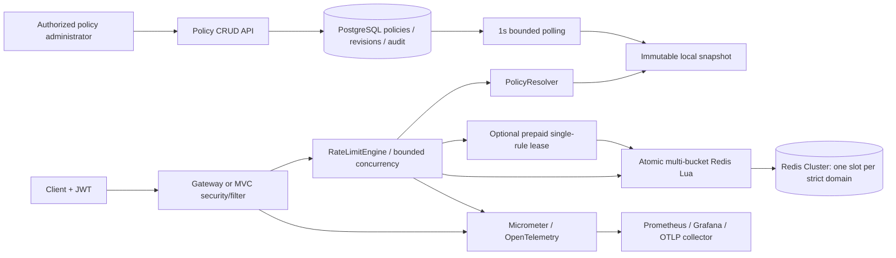

# 2. Architecture

The critical path authenticates the JWT, extracts trusted identity and canonical route/cost, reads a fresh immutable
policy snapshot, resolves overrides, acquires a nonwaiting concurrency permit and executes one Redis script. A
qualifying lease spend avoids Redis but still resolves the snapshot so a local policy revision invalidates the lease.
Neither PostgreSQL nor configuration polling blocks a normal evaluation. A known rejection returns 429; coordination
uncertainty under CLOSED returns 503 to distinguish throttling from outage.

## Deployment choices

| Option                         | Benefits                                                | Cost / semantics                                                                                     | Selection                                        |
|--------------------------------|---------------------------------------------------------|------------------------------------------------------------------------------------------------------|--------------------------------------------------|
| A dedicated evaluation service | Central ownership and upgrades; multi-language callers  | Extra regional hop, serialization, caller identity contract, more availability dependencies          | Included API, suitable when callers cannot embed |
| B embedded in gateway          | One network hop to Redis; native authentication and 429 | Coordinated library rollouts; Redis call per decision                                                | Correctness baseline and default                 |
| C hybrid                       | Amortizes remote calls for hot single-rule traffic      | Reserved capacity waste; delayed token use; scaling/fairness bounds; complex multi-rule reservations | Optional narrow implementation, off by default   |

Token Bucket is selected: O(1) state, controlled burst capacity and smooth refill. Fixed Window permits adjacent-window
bursts up to ~2L, whereas a direct Token Bucket admits at most C+rΔt under its documented clock/failure model (subject
to numerical tolerance). GCRA is a good alternative for one-timestamp state and deterministic spacing; using it only to
demonstrate another algorithm would expand the correctness surface without a measured need. Leaky Bucket suits paced
queues, not immediate admission without queue delay.

| Algorithm       | Mechanism                                              | Per decision time / identity space      | Accuracy and bursts                                   | Distributed cost / trade-off / use                                                        |
|-----------------|--------------------------------------------------------|-----------------------------------------|-------------------------------------------------------|-------------------------------------------------------------------------------------------|
| Fixed window    | Increment counter for time interval                    | O(1) / O(1)                             | Exact count per interval; boundary double burst       | Atomic INCR+TTL script; cheap coarse abuse caps; poor smoothness and fairness             |
| Sliding log     | Store request timestamps; trim old entries             | O(log n+k) / O(n)                       | Exact rolling history; up to L instantaneous requests | Sorted-set memory and trim spikes; timestamp uniqueness; low-volume high-value auditing   |
| Sliding counter | Weighted current/previous windows                      | O(1) / O(1)                             | Approximation sensitive to skew inside prior window   | Two counters and common time; moderate memory; smooth approximate quotas                  |
| Token bucket    | Refill bounded balance; subtract cost                  | O(1) / O(1) per bucket                  | Fractional refill, C burst; explicit cost             | Atomic read/refill/check/write; clock and failover caveats; API default                   |
| Leaky bucket    | Drain queue/balance at constant rate                   | O(1) accounting / O(1), real queue O(n) | Smooth egress; queue waits or drops bursts            | Distributed queue ownership/delivery; bounded queue mandatory; downstream shaping         |
| GCRA            | Compare theoretical arrival timestamp to now+tolerance | O(1) / O(1)                             | Deterministic spacing with configured tolerance       | One timestamp, atomic compare/update; variable costs need care; telecom and strict pacing |

Hash slots are the dominant constraint. All KEYS are tagged `{region-a}` by default, including the policy fence and
bounded identity index. This yields atomic hierarchy but **does not distribute one domain's traffic over Redis shards**.
Adding shards alone does not raise a strict global hot counter's throughput. For real high scale, deploy independent
tenant/region partitions with statically allocated global budgets, or introduce a separately specified multi-level
allocator. The latter is proposed, not implemented. A cross-slot sequential reservation/rollback would incorrectly
consume quota on rejection and is deliberately absent.

PostgreSQL serializes rare writes through a revision row and stores JSONB policy documents plus immutable history.
Snapshot polling uses a repeatable-read transaction; a missed poll retains the previous snapshot for at most 5s. No
Kafka, CQRS, discovery service, or pub/sub delivery dependency is needed for this control plane. Polling has bounded
staleness and is easy to recover after disconnects.

## Regions

| Strategy                        | Latency/isolation                | Accuracy/utilization                                    | Failure behavior                                                                 |
|---------------------------------|----------------------------------|---------------------------------------------------------|----------------------------------------------------------------------------------|
| Region-local independent quotas | Local RTT; isolated              | Sum of independent budgets, not one global limit        | Region failure loses its capacity; no duplication if budgets stay fixed          |
| Static global partition         | Local RTT                        | ΣCᵢ<=C, Σrᵢ<=r; stranded regional quota                 | Reassign only after fencing old allocation and waiting outstanding TTLs          |
| Dynamic regional grants         | Local fast path                  | Better utilization; bounded delayed grants              | Needs durable allocator, fencing and partition protocol; proposed extension      |
| Central global authority        | WAN RTT, weak regional isolation | Single serialized global bucket under healthy authority | Partition forces fail-closed or breaks strictness; unsuitable for <5ms worldwide |

Recommendation: statically partition regional and tenant-domain budgets initially. For millions of requests/second,
measure independent partitions and only then build dynamic allocation if wasted quota justifies it. Do not replicate
Redis active-active counters and call the result strict global enforcement. Global disaster recovery must include quota
exposure from lost primary writes and unreconciled regional grants.

## Optimizations and evidence

| Bottleneck                               | Change implemented                               | Expected benefit / trade-off                                                 | Measurement                                                                   |
|------------------------------------------|--------------------------------------------------|------------------------------------------------------------------------------|-------------------------------------------------------------------------------|
| Database lookup                          | Immutable bounded local snapshot                 | Remove per-decision SQL; <=5s staleness                                      | Cache counters, propagation drills                                            |
| Remote round trips / hierarchy           | One bounded Lua script                           | One request/response; slot contention and O(h) work                          | Redis latency and EVAL commandstats                                           |
| Connection churn                         | Shared multiplexed Lettuce connection per server | Reuse sockets; finite queue                                                  | Connected clients under HPA                                                   |
| Hot single rule                          | Optional <=16-token lease                        | Lower calls on hot identities; wasted tokens and delayed use                 | Compare direct/lease same workload; not target-scale measured                 |
| Identity churn                           | 100k bounded cardinality index                   | Bound retained bucket count; zset operations O(log M) and denial at capacity | Churn workload; actual bytes from MEMORY USAGE                                |
| Resolver scan / synchronized lease cache | No speculative rewrite                           | Simple baseline; can dominate CPU/locks                                      | Profile first; compiled selector indexes and striped leases remain extensions |

MVC uses bounded platform threads, blocking Lettuce futures with explicit timeouts, and a nonwaiting 128-permit engine
bulkhead. WebFlux could avoid blocked servlet threads but cannot remove Redis CPU/RTT bottlenecks; this code does not
mix reactive and blocking JDBC on an event loop. Virtual threads are off: they can reduce thread cost at high I/O
concurrency but do not raise shard capacity and need the same bulkheads. Enable only after measured heap/CPU/latency
comparison. No pipelining of dependent decisions or automatic semantic retries is used.
