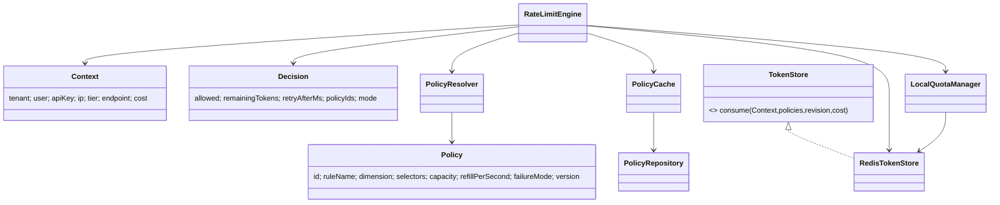

# 3. Low-level design

Packages: `domain` has records and TokenStore port and depends only on Jakarta validation; `application` resolves
immutable policies and coordinates decisions; `infrastructure.redis` implements the TokenStore;
`infrastructure.persistence` owns JDBC/JSON/Flyway data; `security` converts authenticated JWTs; `api` owns HTTP
contracts/headers/filter; `configuration` owns adapters and health. The optional local manager intentionally depends on
the concrete Redis adapter in this small application; there is no abstraction for every class.



```mermaid
sequenceDiagram
  participant C as Authenticated caller
  participant F as Filter / evaluation controller
  participant E as Engine
  participant P as Snapshot + resolver
  participant R as Redis primary
  C->>F: Request with JWT
  F->>F: Verify JWT, extract signed identity and trusted cost
  F->>E: evaluate(context)
  E->>P: fresh snapshot, select overrides
  P-->>E: revision + <=16 rules
  E->>E: nonwaiting bulkhead
  E->>R: EVALSHA(fence,index,bucket keys,caps,rates,cost)
  R->>R: server TIME; read/refill all; validate all
  alt sufficient tokens and identity bound
    R->>R: write all balances, TTLs, revision, index
    R-->>E: allowed + minimum remaining
    E-->>F: allowed
    F-->>C: 200 / downstream execution
  else quota exhausted
    R-->>E: denied + maximum retry delay
    E-->>F: rejected
    F-->>C: 429 + Retry-After
  else timeout / stale revision / cardinality bound
    E-->>F: explicit OPEN fallback or CLOSED unavailable
    F-->>C: 200 fail-open or 503
  end
```

```mermaid
stateDiagram-v2
  [*] --> Absent
  Absent --> Available: first successful evaluation creates full bucket minus cost
  Available --> Available: capped refill then consume
  Available --> Exhausted: consume final tokens
  Exhausted --> Exhausted: rejection; refill only, no deduction
  Exhausted --> Available: sufficient elapsed refill
  Available --> Absent: TTL only after full refill horizon
  Exhausted --> Absent: TTL only after full refill horizon
```



## Arithmetic and key model

`rl:{domain}:revision` is a persistent monotonic policy fence. `rl:{domain}:identities` is a zset of bucket keys scored
by their expiration time, max 100k tracked members. Bucket keys are `rl:{domain}:SHA256(policyId:dimension:identity)`.
Identity is global constant, tenant, tenant:user, tenant:apiKeyId, direct socket IP, or endpoint. Policy ID and
dimension remain stable across updates. Distinct effective policies have separate state even when they share an
inherited rule name, preventing permissive endpoint rules from refilling restrictive endpoint buckets. Creating a new
override ID allocates a new bucket; an update of the existing ID preserves its state. SHA256 is pseudonymization, not
encryption; protect Redis backups as sensitive data. The namespace schema must stay stable during mixed deployments.

Each bucket hash stores `tokens` (fractional double), `at` (Redis milliseconds) and `rate` (tokens/ms).
`effectiveNow=max(now,last)` freezes refill if Redis wall time moves backward. Refill uses min(newRate,storedRate)
during transition and is clamped at capacity. Addition is bounded by capacity before combining; capacities <=1e9 and
times contemporary epochs avoid integer overflow/2^53 loss. A forward Redis clock jump can grant early refill;
discipline Redis clocks and monitor jumps. Failover time movement has the same caveat.

For each rule, `b=min(C,oldBalance+min(C,elapsed*min(r_old,r_new)))`; reject if any b<cost. On rejection no tokens are
deducted; existing bucket refill/parameter metadata is persisted, but absent buckets are not created. Retry is max
across deficits, ceil((cost-b)/r) milliseconds. Remaining is min floor(b-cost). Cost>C returns permanent
`cost-exceeds-capacity`, retryAfter=0; splitting or changing the operation is required. Headers represent the
conjunction's most constrained available balance, not one static policy limit. Fractional boundary tolerance and
millisecond time should be included in property test expectations.

TTL=ceil(C/r)+1s+backward-clock-freeze padding, so expiration cannot refill a nonfull bucket earlier under the assumed
clock model. Index cleanup removes <=64 old entries per call. Lua reads all hash fields/types before token writes; no
arbitrary keys or code from callers. ACLs must prevent external mutations of limiter keys. `noeviction` is mandatory:
LRU eviction replenishes quota. OOM/wrong-type/runtime faults can still violate all-or-none writes because Lua has no
rollback; keep memory headroom and test before production.

## Concurrency and leases

Redis serializes script execution; two clients racing for the last token cannot both succeed on one healthy primary.
Local snapshot publication is volatile; refresh is synchronized. Mutation transactions lock one revision row. Local
lease access uses one monitor so allocation/spend/expiry cannot race; it blocks other lease identities during grant RTT,
a known scalability limitation to measure before enabling. The engine bulkhead caps active decisions without an
unbounded waiting queue. Shared Lettuce connections multiplex and have finite queues; servlet threads/accept queue also
have bounds.

Every granted lease is prepaid, never refilled locally, never returned after expiry/crash/eviction. For N concurrently
active holders each with at most L=16 unused tokens per bucket, request-time admissions in interval Δ can exceed the
direct bucket envelope C+rΔ by at most N*L delayed tokens (plus policy propagation exposure). Allocation-time admission
never exceeds the authority's envelope under healthy-state assumptions. N must be bounded operationally including HPA
surge and terminating pods; otherwise there is no fixed numeric system-wide bound. A crash loses <=L unused tokens, not
extra grants. A rollout invalidates observed revision leases; stale pods can use them until refresh/100ms expiry. No
proactive renewal, refund, reclamation, fairness allocator or regional lease allocator is implemented.

## Persistence/API/error model

Schema: singleton `policy_revision`; `policies(id,version,document jsonb)` current documents;
`policy_history(revision PK,policy_id,actor SHA256,document,changed_at)` immutable writes, including disabled
tombstones. Deletes disable rather than erase inheritance/history; stale bucket state expires naturally. Version
increments globally under revision-row lock. If-Match compares current version; conflicts return 409 and clients reread
before choosing to reapply. Create expects absence. Admin requests are not idempotent blindly: after a timeout, retrieve
current version/history rather than repeating writes with a new expected version.

See OpenAPI for contracts. Native requests get 429/Retry-After (seconds rounded up), RateLimit-Remaining and
X-RateLimit-Mode; response Cache-Control no-store. These are documented application headers, not a claim of complete
support for every evolving IETF RateLimit draft. Evaluation 429 has a structured Decision body; CLOSED dependencies
return 503 ProblemDetail; invalid input 400; auth 401/403; oversize 413. No API includes caller-chosen identity. Live
decision inspection via evaluation consumes tokens; effective-policy and policy/version queries do not consume.
`GET /api/v1/rate-limits/status?endpoint=/protected/demo` reports an atomic distributed balance projection without token
deduction or new bucket creation (expired index housekeeping may run). It excludes prepaid tokens held locally and does
not promise a later request will see the same balance.
